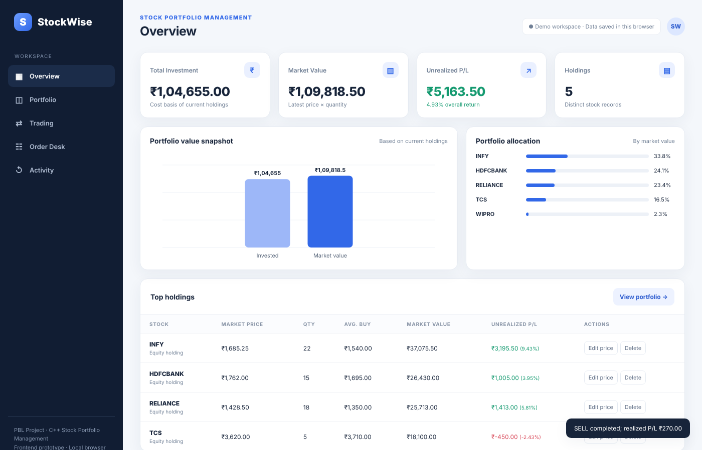
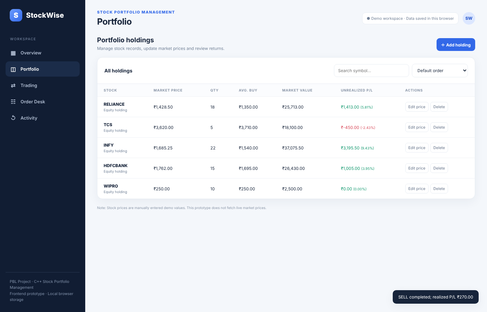
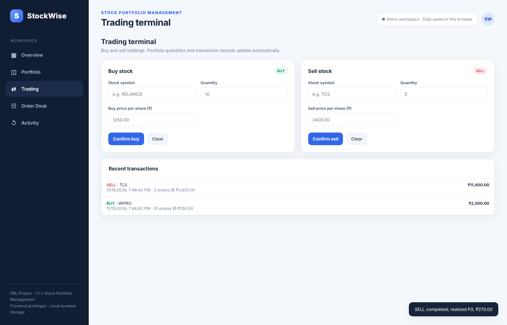

# StockWise – Stock and Portfolio Management System

A simulated stock and portfolio management system built for the **Project Based Learning (PBL)** course at Graphic Era Hill University. It shows how fundamental **Data Structures** and **Object-Oriented Programming** concepts solve a practical financial-management problem.

> StockWise is for simulation and learning only. It does not place real trades or fetch live market prices.

## Overview

The project has two parts built around the same logic:

| Part | Location | Description |
|------|----------|-------------|
| C++ core | `src/stockwise.cpp` | 26-option console application demonstrating the DSA and OOP concepts |
| Web dashboard | `web/index.html` | Single-file HTML/CSS/JavaScript interface; data is saved in the browser (localStorage) |

The web dashboard does not call the C++ program. It is a parallel implementation of the same rules in JavaScript.

## Features

**Portfolio management**
- Add, search, delete and update holdings
- Sort by current price or quantity; rank holdings by unrealized profit/loss
- Dashboard: total investment, market value, unrealized P/L, return %, best/worst holding, allocation report

**Trading**
- Buy (recalculates average buy price) and sell (calculates realized P/L; removes a holding when quantity reaches zero)
- Transaction history, newest first

**Orders and activity**
- Normal order queue (FIFO) and priority queue (highest priority first, arrival order for ties)
- Action history log (stack, newest first)

## Data structures and OOP concepts

| Concept | Where it is used |
|---------|------------------|
| Linked list | Portfolio holdings, priority queue |
| Stack (array) | Action history |
| Queue (circular array) | Pending normal orders |
| Priority queue | Urgent orders |
| Array | Transaction records, queue and stack storage |
| Searching / sorting | Search by name; bubble sort by price and quantity; P/L ranking |
| Constructors, copy constructor, destructor | `Stock`, `Portfolio` |
| Static members | Live-object and record counters in `Stock` |
| Friend function | `showPrivateStockDetails` |
| Operator overloading | `<`, `>` on `Stock`; `=` on `Stock` and `Portfolio` |
| Pointers and dynamic memory | Linked-list nodes, temporary array in ranking |

## Getting started

### C++ console application

Requires a C++11 compiler (g++, clang++ or MSVC).

```bash
make          # builds ./stockwise
make run      # builds and runs
make clean
```

Without make:

```bash
g++ -std=c++11 -Wall -o stockwise src/stockwise.cpp
./stockwise
```

Stock names must not contain spaces and are case-sensitive. A sample session is in `docs/sample_run.txt`.

### Web dashboard

Open `web/index.html` in any modern browser. No installation or internet connection is needed. Demo data is loaded on the first visit; clear the site data in your browser to reset it.

## Project structure

```
StockWise/
├── src/stockwise.cpp        # C++ core
├── web/index.html           # Web dashboard
├── docs/
│   ├── sample_run.txt
│   └── screenshots/
├── Makefile
├── LICENSE
└── README.md
```

## Screenshots

| Overview | Portfolio | Trading |
|----------|-----------|---------|
|  |  |  |

## Limitations

- Prices are entered manually; there is no live market data.
- Queue and stack hold 50 items; the transaction log holds 200.
- Order queues store order IDs only and do not trigger trades automatically.
- The C++ program and web dashboard are separate; data is not shared between them.
- The C++ program is case-sensitive, while the web dashboard converts names to upper case.

## Team Avengers

| Name | Student ID | Main modules |
|------|-----------|--------------|
| Ujjwal Painuly (Team Lead) | 25101280140 | Operator overloading, friend function, search, action stack, transactions |
| Arnim Uniyal | 25101280154 | Stock class, sorting, ranking |
| Pawan | 25101280967 | Portfolio linked list, deep copy, dashboard |
| Sameer Bisht | 25101281897 | Order queue, priority queue, user class |

## License

Released under the MIT License (see `LICENSE`).
